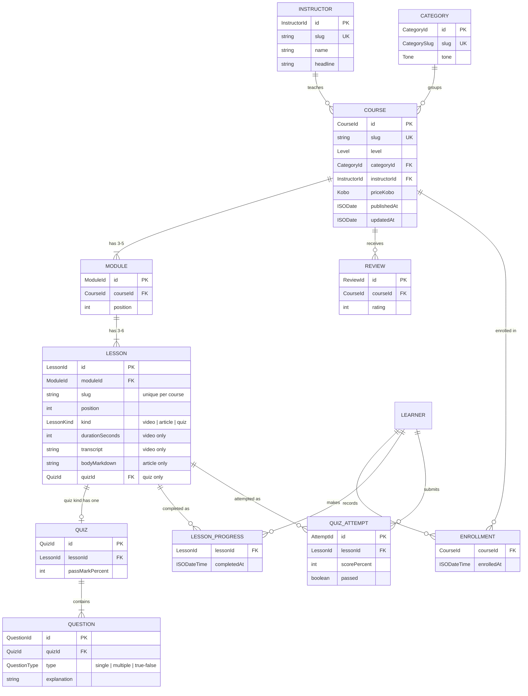

# Ìmọ̀ — short, practical courses for Nigerian learners

**Day 14 of my 30-day dev challenge.** *Ìmọ̀* (EE-maw) is Yoruba for "knowledge". It is an online learning platform with short courses in tech skills, small business, money skills and exam prep.

The features are real, but **today's lesson is TypeScript and data modelling** in the Next.js App Router: Zod schemas as the single source of truth, branded IDs, discriminated unions with exhaustive `never` checks, utility types used on purpose, relationships by ID, a seed-data checker that fails loudly, and a versioned, schema-checked localStorage store.

> **Sample content.** Every course, lesson, quiz, instructor and review in `/data` was written for this demo. The people are fictional. Paid courses use a demo checkout (no payment is taken), the videos are placeholders with real transcripts, and certificates are not accredited.

---

## What it does

| Page | What you can do |
| --- | --- |
| `/` | Featured courses, categories, instructors and "Continue learning" for your enrolled courses |
| `/courses` | Catalogue with filters (category, level, free/paid, duration) and sort, all kept in the URL |
| `/courses/[slug]` | Course outline with module and lesson durations, what you'll learn, instructor, reviews and an enroll button |
| `/learn/[courseSlug]/[lessonSlug]` | Lesson player: sidebar outline with ticks, video/article/quiz views, mark as complete, previous/next |
| (quizzes) | Answer, submit, see your score and every explanation, retake; your best score is kept; pass mark 70% |
| `/dashboard` | Your courses with progress bars, lessons completed, quiz scores, a learning streak, and demo tools for the saved data |
| `/certificate/[courseSlug]` | A printable certificate once every lesson is complete and every quiz passed; otherwise, exactly what's left |
| `/instructors/[slug]` | Instructor profile with their courses |

The seed data has 8 courses, 29 modules, 102 lessons (videos, articles and quizzes), 111 questions, 4 instructors, 5 categories and 20 reviews.

## Run it

```bash
npm install          # also runs `next typegen` (route types for PageProps)
npm run dev          # http://localhost:3000

npm run check:data   # validate every seed row and every reference
npm run typecheck    # next typegen && tsc --noEmit
npm run lint
npm run build && npm start
```

Stack: **Next.js 16.4** (App Router, Turbopack, Cache Components), **React 19.3**, **TypeScript 5** (`strict` + `noUncheckedIndexedAccess`), **Tailwind CSS 4.3**, **Zod 4.6**. No UI libraries: the icons, Markdown renderer and components are all in this repo.

## Project structure

```
app/
  layout.tsx                    root: fonts, no-flash theme script, skip link
  (site)/                       route group with the site header and footer
    page.tsx                    home
    courses/page.tsx            catalogue (searchParams parsed with Zod)
    courses/[slug]/             course page (+ loading, not-found)
    instructors/[slug]/         instructor profile
    dashboard/                  learner dashboard
    certificate/[courseSlug]/   printable certificate
  (learn)/learn/[courseSlug]/   calm lesson-player layout with the outline sidebar
    [lessonSlug]/page.tsx       one lesson (+ loading, not-found, error)
data/                           SAMPLE seed data: flat, typed rows (one file per course)
lib/
  schema/                       Zod schemas — every entity type comes from here
  data.ts                       THE data access layer (server-only, async, cached)
  progress.ts                   THE learner progress store (client-only, localStorage)
  outline.ts                    joins rows by ID into a course outline; calculates stats
  seed.ts                       seed validation (schemas + references)
  lessons.ts, quiz.ts           logic per lesson kind / question type (exhaustive switches)
  learning.ts                   progress maths: % complete, best scores, certificate, streak
  money.ts                      kobo → naira, in one place
  markdown.ts                   tiny typed Markdown parser for article lessons
scripts/check-data.ts           npm run check:data
```

---

## The data model



### Why it's shaped like this

**1. Relationships by ID, not nested objects.** Each entity is a flat list of rows that point at each other by ID (`course.instructorId`, `module.courseId`, `lesson.moduleId`, `question.quizId`…). Ngozi teaches two courses, but her bio exists once. Nothing is copied, so nothing can drift. These lists *are* the database tables we'll create on Day 16, column for column.
The trade-off: a page that wants "the course with everything" must put the pieces back together. That's `buildCourseOutline()` in [lib/outline.ts](lib/outline.ts), the JavaScript version of a SQL `JOIN`, made cheap with an index of Maps built once.

**2. Course duration, lesson count and average rating are calculated, never stored.** Duration is the sum of the lesson durations, the article reading time comes from the word count, and the rating is the average of the reviews. A stored copy would go stale the moment someone adds a lesson or a review, and then two numbers that should agree would disagree. (Quiz *attempts* do store their score, deliberately: an attempt is a record of what happened at the time, and rewording a question next month must not change last month's result.)

**3. Money in kobo.** Like my Day 9 and Day 12 projects: prices are whole numbers of kobo (`450_000` = ₦4,500) and become text in exactly one function, `formatNaira()` in [lib/money.ts](lib/money.ts). A price of `0` means free, so there's no separate `isFree` flag to contradict it.

**4. Durations in seconds, dates as ISO strings.** One unit everywhere, formatted in one place ([lib/format.ts](lib/format.ts)). Calendar days for streaks are Lagos days ([lib/dates.ts](lib/dates.ts)).

**5. Schema first.** Each shape is written once, as a Zod schema, and the TypeScript type is derived with `z.infer`. Writing a `type Course = {...}` *and* separate validation code means two copies that drift apart: add a field to the type, forget the validator, and bad data gets through while the compiler says everything is fine. A derived type can't disagree with its check, because it *is* the check. The same schemas validate the seed data, the URL and localStorage, and on Day 16 they'll validate database rows.

---

## TypeScript concepts and where they live

| Concept | File | One-line explanation |
| --- | --- | --- |
| Types from schemas (`z.infer`) | [lib/schema/catalog.ts](lib/schema/catalog.ts) | Each shape is defined once; the type is derived, so it can't drift from the runtime check. |
| `z.input` vs `z.infer` | [lib/schema/tables.ts](lib/schema/tables.ts), [data/types.ts](data/types.ts) | Seed files use the *input* type (plain strings, optional defaults); the app uses the *output* type (branded, defaults filled). |
| Branded types | [lib/schema/ids.ts](lib/schema/ids.ts) | `CourseId` and `LessonId` are both strings at runtime but different types to the compiler. |
| Discriminated unions | [lib/schema/lesson.ts](lib/schema/lesson.ts) | `Lesson` is video \| article \| quiz, told apart by `kind`; `Question` likewise by `type`. |
| Exhaustive `switch` + `never` | [lib/guards.ts](lib/guards.ts), [lib/lessons.ts](lib/lessons.ts) | `assertNever(x: never)` makes an unhandled case a compile error. |
| Type predicates (guards) | [lib/guards.ts](lib/guards.ts) | `isQuizLesson(l): l is QuizLesson` narrows, even inside `.filter()`. |
| Generic guard factory | [lib/guards.ts](lib/guards.ts) | `isLessonKind<K>()` builds a correctly narrowed guard for any kind. |
| `Extract` / `Exclude` | [lib/types.ts](lib/types.ts) | `LessonDetail` = non-quiz lessons, or a quiz lesson with its questions joined in. |
| `Pick` | [lib/types.ts](lib/types.ts) | `CourseSummary` and `ProgressOutline` carry only what cards and progress need. |
| `Omit` | [lib/types.ts](lib/types.ts), [lib/progress.ts](lib/progress.ts) | `LessonSummary` drops the content; `NewQuizAttempt` drops what the store adds. |
| `Partial` | [lib/types.ts](lib/types.ts), [lib/quiz.ts](lib/quiz.ts) | Filters are "some of these"; an answer sheet has no entry for unanswered questions. |
| `Record` | [lib/constants.ts](lib/constants.ts), [lib/data.ts](lib/data.ts) | Label and sorter lookups that must have an entry for *every* key. |
| `readonly` | [lib/schema/tables.ts](lib/schema/tables.ts), [data/](data/) | Seed tables can't be pushed to or reassigned anywhere in the app. |
| `as const` | [lib/constants.ts](lib/constants.ts) | Keeps `['beginner', …]` as literal types so the union can be derived from the list. |
| `satisfies` | [lib/constants.ts](lib/constants.ts), [data/categories.ts](data/categories.ts) | Checks a value against a type without widening the value's own type. |
| Indexed access types | [lib/schema/lesson.ts](lib/schema/lesson.ts), [lib/constants.ts](lib/constants.ts) | `Lesson['kind']` and `(typeof LEVELS)[number]` read types off other types. |
| `keyof typeof` | [components/ui/icon.tsx](components/ui/icon.tsx) | `IconName` is the union of the icon object's keys; a typo'd icon is an error. |
| Mapped types | [lib/schema/tables.ts](lib/schema/tables.ts), [data/types.ts](data/types.ts) | `Tables` and `CourseBundle` are generated from the list of table names. |
| `-readonly`, conditional types, `infer` | [scripts/broken-seed.ts](scripts/broken-seed.ts) | `DeepMutable<T>` strips readonly all the way down for a private broken copy. |
| Generics with constraints | [lib/collections.ts](lib/collections.ts) | `groupBy<T, K extends PropertyKey>` works for any list and any key type. |
| Generic `Result<T, E>` | [lib/result.ts](lib/result.ts) | Failure is part of the return type, so callers must handle it. |
| Typed error unions | [lib/outline.ts](lib/outline.ts), [lib/progress.ts](lib/progress.ts) | `OutlineError` and `LoadProblem` list every way a call can fail, with details. |
| `unknown`, not `any` | [lib/progress.ts](lib/progress.ts), [lib/seed.ts](lib/seed.ts) | `JSON.parse` output goes straight into `unknown` and is parsed before use. |
| Compile-time type test | [lib/search-params.ts](lib/search-params.ts) | `Equals<A, B>` fails the build if the URL schema and `CatalogQuery` drift. |
| `noUncheckedIndexedAccess` | [lib/data.ts](lib/data.ts), [lib/markdown.ts](lib/markdown.ts) | `array[i]` is `T \| undefined`, so out-of-range reads are handled honestly. |
| `import type` | [lib/learning.ts](lib/learning.ts) | Uses `ProgressState` without loading the client-only progress module. |
| `PageProps` / `LayoutProps` | [app/(site)/courses/[slug]/page.tsx](<app/(site)/courses/[slug]/page.tsx>) | Route types generated from folder names; `params` is a typed Promise. |
| Generic hooks | [components/lesson/lesson-sidebar.tsx](components/lesson/lesson-sidebar.tsx) | `useParams<{ lessonSlug?: string }>()` types the URL params a component reads. |

### Exhaustiveness in action

Every place that handles lesson kinds ends in `default: return assertNever(lesson)`. To see what that buys, I added a fourth kind to the schema:

```ts
export const AssignmentLessonSchema = LessonBaseSchema.extend({ kind: z.literal('assignment'), brief: z.string() })
export const LessonSchema = z.discriminatedUnion('kind', [VideoLessonSchema, ArticleLessonSchema, QuizLessonSchema, AssignmentLessonSchema])
```

…and ran `npx tsc --noEmit` (real output, long types shortened to `AssignmentLesson`):

```
components/lesson/lesson-kind-icon.tsx(15,26): error TS2345: Argument of type '"assignment"' is not assignable to parameter of type 'never'.
components/lesson/lesson-view.tsx(28,26): error TS2345: Argument of type 'AssignmentLesson' is not assignable to parameter of type 'never'.
lib/data.ts(206,26): error TS2345: Argument of type 'AssignmentLesson' is not assignable to parameter of type 'never'.
lib/lessons.ts(45,26): error TS2345: Argument of type 'AssignmentLesson' is not assignable to parameter of type 'never'.
lib/lessons.ts(57,12): error TS1360: Type '{ readonly video: "Video"; readonly article: "Reading"; readonly quiz: "Quiz"; }'
  does not satisfy the expected type 'Record<"video" | "article" | "quiz" | "assignment", string>'.
  Property 'assignment' is missing ...
lib/lessons.ts(67,17): error TS7053: Element implicitly has an 'any' type because expression of type
  '"video" | "article" | "quiz" | "assignment"' can't be used to index type '{ readonly video: ...; readonly quiz: "Quiz"; }'.
lib/lessons.ts(75,26): error TS2345: Argument of type '"assignment"' is not assignable to parameter of type 'never'.
lib/seed.ts(170,21): error TS2345: Argument of type 'AssignmentLesson' is not assignable to parameter of type 'never'.
```

That's a to-do list of **exactly** the places that need updating: the icon, the player view, the data layer's content join, the duration calculation, the labels (`Record` + `satisfies` catch that one), the outline description and the seed checker. Nothing else is listed, and nothing that needs updating is missed. (I reverted the change; it isn't committed.)

### Branded IDs in action

```ts
const lessonId = LessonIdSchema.parse('les_web-1-1')
getCourseReviews(lessonId)   // wrong kind of ID
getCourseReviews('crs_web')  // a plain string that was never checked
```

```
error TS2345: Argument of type 'string & $brand<"LessonId">' is not assignable to parameter of type 'string & $brand<"CourseId">'.
error TS2345: Argument of type 'string' is not assignable to parameter of type 'string & $brand<"CourseId">'.
```

At runtime a `CourseId` is still just a string; the brand exists only for the compiler. The only way to get one is through the schema, so every ID in the app has been validated somewhere (seed data, URL or localStorage).

---

## Checking the seed data: `npm run check:data`

Stage 1 parses every row with its Zod schema (each row on its own). Stage 2 checks rows **against each other**, which no single-row schema can do: every ID points at a real row, IDs and slugs are unique (lesson slugs within their course), quiz answers point at real options, each quiz belongs to exactly one quiz lesson, each course has 3–5 modules of 3–6 lessons with positions 1, 2, 3…, and each course mixes all three lesson kinds. On Day 16, foreign keys and `UNIQUE` constraints take over much of this job.

```
$ npm run check:data

Ìmọ̀ seed data check
✓ Stage 1 · schemas      4 instructors, 5 categories, 8 courses, 29 modules, 102 lessons, 29 quizzes, 111 questions, 20 reviews
✓ Stage 2 · references   every ID points at a real row; slugs unique; answers valid

✓ Seed data is valid.
```

### A deliberately broken example

`npm run check:data -- --broken` runs the same checks on a copy of the seed with four faults planted (see [scripts/broken-seed.ts](scripts/broken-seed.ts)). Real output, exit code **1**:

```
Ìmọ̀ seed data check  (deliberately broken copy)
Changes made to the copy:
  • courses crs_web: instructorId set to "ins_nobody"
  • courses crs_excel: slug set to "build-your-first-website" (already used)
  • lessons les_web-1-2: moduleId set to "mod_does-not-exist"
  • questions q_web-1-1: correctOptionId set to "f" (not one of its options)
✓ Stage 1 · schemas      4 instructors, 5 categories, 8 courses, 29 modules, 102 lessons, 29 quizzes, 111 questions, 20 reviews
✗ Stage 2 · references: 6 problems

  ✗ duplicate  courses.slug
      "build-your-first-website" is used more than once
  ✗ reference  courses crs_web
      instructorId "ins_nobody" does not match any instructor
  ✗ rule       modules mod_web-1
      has 2 lessons (expected 3 to 6)
  ✗ rule       modules mod_web-1
      lessons positions are [1, 3], expected [1, 2]
  ✗ reference  lessons les_web-1-2
      moduleId "mod_does-not-exist" does not match any module
  ✗ reference  questions q_web-1-1
      correctOptionId "f" is not one of the options (a, b, c, d)

✗ Seed data is broken. Fix the problems above before running the app.
```

Every row in the schemas is still valid, so Stage 1 passes. The faults are relationships, which is exactly why Stage 2 exists. One moved lesson also breaks its old module's rules, and the report says so.

---

## Learner progress (no accounts yet)

One demo learner. Enrollments, lesson progress and quiz attempts are saved in `localStorage` under `imo-progress`, and **only** [lib/progress.ts](lib/progress.ts) reads or writes it. Components use `useProgress()` (built on `useSyncExternalStore`, so every component updates together, and other tabs stay in sync through the `storage` event) and call `progressActions.enroll()`, `.setLessonComplete()`, `.recordQuizAttempt()` and so on.

**Why saved data needs a schema, just like API data:** what you read back from localStorage may have been written by an *older* version of the app, edited by hand, half-written when a tab crashed, or written by a *newer* version in another tab after a deploy. To the code it's input from outside, and TypeScript types don't exist at runtime, so it's parsed with Zod like anything else. Every outcome has a planned answer:

| What's stored | What happens |
| --- | --- |
| Nothing | A fresh, empty state |
| Version 2 (current) | Used as is |
| Version 1 (older shape) | `migrateV1toV2()` upgrades it, the old copy is kept in `imo-progress:backup`, and a notice says "updated from an older version" |
| Corrupt JSON, or wrong shape | A fresh state; the original is kept as a backup and a notice explains |
| Version 3+ (from a newer app) | Same: never overwrite data we don't understand without keeping a copy |
| Storage blocked | Works for this visit, with a notice |

The parsing is a pure function, `parseStoredProgress(raw, now): Result<…, LoadProblem>`, so it never throws and is easy to test. **Version 1** stored flat ID lists and one score per quiz; **version 2** adds timestamps (for streaks), full attempts and the learner's display name. The dashboard's **Demo tools** load a v1, corrupt or "future" save so you can watch each path.

Completing a quiz lesson means passing it (≥ 70%); every attempt is kept and the best score shown. The certificate unlocks when every lesson is complete and every quiz passed; otherwise the page lists what's left.

---

## Next.js notes (16.4)

- **Cache Components** are the default for new apps in 16.4, so they're on. Every read in `lib/data.ts` is `'use cache'` + `cacheLife('max')`, and `generateStaticParams` prerenders all 8 course pages, 102 lessons, 4 instructors and 8 certificate pages (140 pages in total).
- `params` and `searchParams` are **Promises** and are awaited. Pages are typed with the generated `PageProps<'/courses/[slug]'>` / `LayoutProps<…>` helpers.
- The catalogue reads `searchParams` inside a `<Suspense>` boundary, so its heading is part of the static shell and the results stream in. A bad URL (`/courses?level=banana&sort=zzz`) falls back to defaults field by field instead of crashing.
- Server Components by default. Every Client Component starts with a comment saying why it needs the browser (localStorage, state, effects, `usePathname`/`useParams`, `window.print`).
- An unknown slug renders the right not-found page. Because the page shell has already started streaming, the HTTP status stays `200` with a `noindex` tag (this is documented Next.js behaviour with Cache Components, where `dynamicParams = false` isn't available). A Proxy check could return a real `404` later.

## Design and accessibility

- Palette "Adire": unbleached-cotton page, indigo-dye brand, kola-red accent, defined once as `light-dark()` tokens in `@theme` ([app/globals.css](app/globals.css)). Light/dark follows the OS, and a toggle saves a choice; a tiny `<head>` script applies it before first paint, so there's no flash.
- **Fonts that can write Yoruba.** Yoruba puts a tone mark *on top of* a dot-below letter (ọ̀, ẹ́), which needs a combining accent the font must position. My first display font rendered "Adébáyọ̀ Ọlọ́lá" as "Adébáyọ\`Ọlọlá". After rendering candidates side by side, I chose **Literata** (display) and **Be Vietnam Pro** (text), which place every mark correctly.
- The lesson player has its own calm layout: slim bar, outline sidebar (a `<details>` on phones), a narrow reading column and no promotions.
- Keyboard: a skip link, visible focus rings, focus moved to quiz results and error summaries, and `aria-current` on the current lesson and filters. Quiz questions are `<fieldset>`/`<legend>` with labelled radios and checkboxes; results are announced through a live region. Every cover image has alt text from the data (the schema requires it). `prefers-reduced-motion` turns animation off.
- Checked at 360px wide (no horizontal scroll on any page, light and dark). The certificate prints on one A4 landscape page.

---

## Day 16: moving to PostgreSQL

The two "one module" rules are what make this a swap, not a rewrite:

- **`lib/data.ts`**: the `/data` arrays become tables with the same columns (`courses`, `modules`, `lessons`, `quizzes`, `questions`, `reviews`, …), the IDs become primary keys and the `…Id` fields foreign keys. Each function keeps its name, arguments and return type; only its body changes from array lookups to queries (the JOIN in `buildCourseOutline` becomes SQL, and the stats become `SUM`/`COUNT`/`AVG`). Rows are still parsed with the same Zod schemas. Caching gains `cacheTag('course:<id>')`, and saves call `revalidateTag()`. Pages don't change.
- **`lib/progress.ts`**: `enrollments`, `lesson_progress` and `quiz_attempts` become tables with a `learner_id` column. The actions become **server actions** that check the signed-in learner. Quiz grading moves to the server, so the browser no longer receives the correct answers. Existing localStorage progress can be offered as a one-time import: it already has a schema and a version number.

## Worth adding later (not built today)

Real accounts and payments (Paystack/Flutterwave), video hosting with captions, instructor course editing, and AI features are planned for Days 16–30. Other ideas:

- Server-side quiz grading and enrollment checks
- Search across courses and lessons; course and lesson bookmarks
- Unit tests (Vitest) for `lib/quiz.ts`, `lib/learning.ts`, the v1→v2 migration and the seed checker
- Offline reading / a PWA for low-data learners; downloadable transcripts
- UI in Yoruba, Hausa, Igbo and Pidgin
- A Proxy check so unknown slugs return a real `404`
- `typedRoutes` for compile-checked links
- Discussion per lesson, and reminders to keep a streak going
